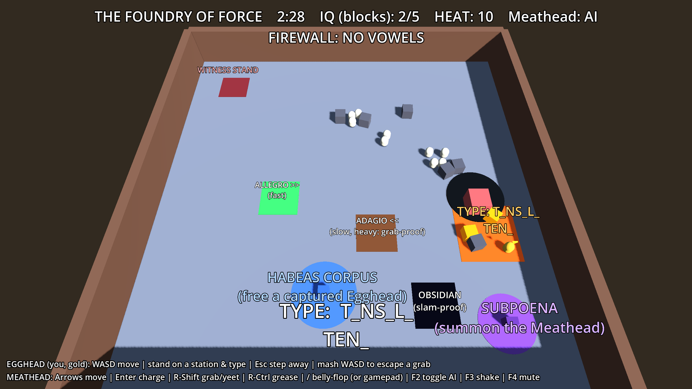

# Eggheads vs. Meatheads — Proof of Concept

A playable grey-box slice of the design docs in this repo: **"The Foundry of Force"**.



It covers the scope set out in *Proof of Concept Readiness Assessment.txt*:

| PoC requirement | What's in the build |
|---|---|
| Flat arena, 10 Eggheads vs 1 Meathead (scaled-down 10:1) | 40×40 arena; you + 9 bot Eggheads vs 1 Meathead |
| One Egghead objective | Push iron blocks onto **The Forge**, stand on it and **type the engineering term** (TRUSS, CANTILEVER, TENSILE…) to temper one. Temper **5** before the **3:00** clock runs out. |
| One Meathead disruption | **Charge** (cracks Eggheads), **belly-flop** (area stun), **grab & yeet** (wall splat = stun), **grease spill** |
| One stealth-learning mechanic | **HABEAS CORPUS** terminal: type the writ to free a captured Egghead, stun the Meathead and raise a barrier. Bonus tiles: **ALLEGRO** (speed) and **OBSIDIAN** (immune to belly-flop). |
| Fragile vs clumsy physics | Eggheads crack and respawn in the Library after 4s. The Meathead has deliberately delayed input, sluggish turning while charging, and is winded after a belly-flop. |
| Scoring | Eggheads: blocks tempered (IQ). Meathead: **Heat** from cracks, yeets, splats and flops. |
| Feedback | Synthesized sound effects for every action and a trauma-based screen shake that scales with impact (cracks, splats and belly-flops hit hardest). |

## Controls

**Egghead (you, the gold egg with the marker):** `WASD` move · walk onto a station and type the
word shown (movement is frozen while typing) · `Esc` step away · mash `WASD` to wriggle out of a grab.

**Meathead:** an AI plays it by default so you can test solo. A second player takes over automatically
when they touch its controls:
- Keyboard: arrow keys move · `Enter` charge · `Right Shift` grab/yeet · `Right Ctrl` grease · `/` belly-flop
- Gamepad: left stick · `A` charge · `X` grab/yeet · `B` grease · `Y` belly-flop
- `F2` toggles the Meathead between AI and human.

`F3` toggles screen shake · `F4` mutes sound.

`R` restarts once a round is over.

## Running it

Requires **Godot 4.2.x** (standard build, not .NET). Open `EggheadsVsMeatheads/project.godot` in the
editor and press **F5**, or run it from the command line:

```bash
cd EggheadsVsMeatheads && godot
```

The project uses the **Compatibility** renderer so the same build runs on desktop and in the browser.

## Tests

The headless test suite loads the real `main.tscn` and steps physics, covering grab/yeet/wall-splat,
charge-crack/respawn, belly-flop vs Obsidian, Allegro, grease, Habeas Corpus, Esc-to-cancel, the forge
win condition, the timer loss, struggle-free, sound synthesis, screen shake, and a 40-second AI-vs-bots soak:

```bash
cd EggheadsVsMeatheads && godot --headless --fixed-fps 60 -s res://tests/test_suite.gd
```

## Web build / CI

`.github/workflows/deploy.yml` runs the tests on every PR and push. On `main` it then exports the
Web build and publishes it to GitHub Pages. In the repo settings, set Pages' source to
**GitHub Actions** for the deploy step to work.

## Project layout (`EggheadsVsMeatheads/`)

| File | Role |
|---|---|
| `main.tscn` / `game.gd` | Match controller: spawning, timer, score/Heat, HUD, win/lose, restart |
| `egghead.gd` | Player + bot Egghead: movement, crack/respawn, stun, grease, being held, bot AI |
| `meathead.gd` | Meathead: clumsy movement, charge, grab/yeet, grease, belly-flop, AI |
| `typing_station.gd` | Shared "stand here and type" logic |
| `terminal.gd` | HABEAS CORPUS terminal |
| `forge.gd`, `foundry_block.gd` | The objective |
| `effect_tile.gd` | ALLEGRO / OBSIDIAN floor tiles |
| `grease_spill.gd` | Meathead grease |
| `controls.gd` | Autoload that defines every input binding |
| `sfx.gd` | Autoload that synthesizes all sound effects at startup (no audio files) |
| `camera.gd` | Arena camera with screen shake (`add_trauma`) |
| `tests/test_suite.gd` | Headless gameplay tests |

## Not in the PoC (deliberately)

Online multiplayer (44 players), hardware detection, the pre-match "Pick Your Poison" firewall,
progression/unboxing, and the other learning modules. The input, station and tile scripts are built
so those can be added without rework.
